 

 

> **«Любая система оставляет след, а любой периметр рано или поздно проверяют на прочность.»**  
> Я строю эшелонированную защиту корпоративной инфраструктуры, расследую инциденты, нахожу цифровые следы в открытых источниках и создаю автономные инструменты на стыке **ИБ**, **OSINT** и **ИИ**.

 

## ⚡ // `0x01` · Д0М3НЫ И С3КТ0РЫ

<table>
<tr>
<td width="50%" valign="top">

**🛡️ `[1NF0S3C]` Инфраструктурная и сетевая защита** 
Проектирование защищённых сегментов сети и контроль потоков данных. Промышленная эксплуатация <b>NGFW</b>, построение отказоустойчивых корпоративных VPN-сетей и криптошлюзов (включая <b>ViPNet</b>), внедрение и тонкая настройка <b>DLP-систем</b>, харденинг узлов, моделирование угроз и архитектура <b>Zero Trust</b>.

</td>
<td width="50%" valign="top">

**📡 `[S0C_0PS]` Мониторинг, детект и реагирование** 
Выстраивание наблюдаемости и пайплайнов <b>Blue Team</b>. Сбор, нормализация и корреляция событий в <b>SIEM</b> и на стеке <b>ELK</b> (Elasticsearch · Logstash · Kibana), автоматизация плейбуков реагирования в <b>SOAR</b>, телеметрия конечных точек через <b>EDR</b>, разбор сетевых дампов и вредоносных документов.

</td>
</tr>
<tr>
<td width="50%" valign="top">

**🔎 `[0S1NT]` Киберразведка и цифровые следы** 
Поиск сигнала в терабайтах открытых данных. Глубокий рекон инфраструктуры, анализ графов связей, <b>GEOINT</b> и <b>SOCMINT</b>, профилирование поверхности атаки, деанонимизация узлов и атрибуция источников угроз до того, как они постучатся в периметр.

</td>
<td width="50%" valign="top">

**🤖 `[4I_LAB]` Искусственный интеллект и автоматизация** 
Прикладной ИИ для задач безопасности и разведки. Проектирование локальных и автономных <b>LLM-агентов</b>, автоматизация первичного триажа алертов SOC и OSINT-сбора, классификация обфусцированного кода и извлечение сущностей из неструктурированных массивов.

</td>
</tr>
</table>

 

## 🧰 // `0x02` · Т3ХСТ3К И 4РС3Н4Л

| Сектор | Инструменты и технологии |
|---|---|
| 🔥 **Сеть и периметр** | `NGFW` · `ViPNet` · `IPsec / WireGuard / AmneziaWG` · `DLP` · `Zero Trust` · `TLS / PKI` |
| 👁️ **Стек SOC & Blue Team** | `SIEM` · `SOAR` · `EDR` · `ELK Stack (Elastic / Logstash / Kibana)` · `Suricata / Zeek` · `YARA / Sigma` |
| 🕵️ **OSINT & Анализ** | `DNS / BGP / ASN Recon` · `Maltego / графы связей` · `Wireshark / tcpdump` · `Static & Sandbox Doc Analysis` |
| 💻 **Разработка и ИИ** | `Rust` · `Python` · `TypeScript` · `WebAssembly` · `Linux` · `Docker` · `LLM Agents / RAG` |

 

## 🚀 // `0x03` · ПР03КТЫ [@team-ph4r0s](https://github.com/team-ph4r0s)

<table>
<tr>
<td width="50%" valign="top">

### 🛡️ [Arca](https://github.com/team-ph4r0s/arca)
`Safe Rust` · `Wasm` · `Android` · `iOS`

Параноидально безопасный просмотрщик документов (Office, PDF, RTF, Visio, Access, картинки). Разбирает файлы внутри одноразовой Wasm-песочницы с нулём импортов и без доступа к сети, проводит «рентген» макросов (VBA/XLM/DDE), ловит утечки NTLM/UNC и собирает стерильные копии в один тап.

</td>
<td width="50%" valign="top">

### 🧠 [dementia-panel](https://github.com/team-ph4r0s/dementia-panel)
`TypeScript` · `Docker` · `AmneziaWG`

Agentless-панель управления VPN-серверами AmneziaWG 3.x по SSH. Горячая синхронизация без разрыва туннелей, автообновляемые подписки, отказоустойчивые мосты, проверка доступности нод из разных стран и шифрованные бэкапы.

</td>
</tr>
</table>

 

<code>// S74Y CUR10US · TRUS7 N0 B1N4RY · K33P TH3 S1GN4L CL34N //</code>

